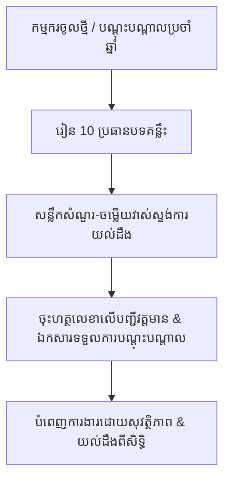
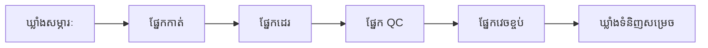

# កញ្ចប់ឯកសារវគ្គបណ្តុះបណ្តាលស្តង់ដាររោងចក្រ
## (Factory Training Curriculum & Operations Manual)

> **ប្រព័ន្ធគ្រប់គ្រង និងតាមដានឯកសារ (Document Control):**  
> * **កូដឯកសារ:** `SOP-TR-2026-V1`  
> * **កំណែប្រែ (Revision):** 1.0 (កំណែពេញលេញ / Master Edition)  
> * **កាលបរិច្ឆេទអនុវត្ត:** ខែវិច្ឆិកា ឆ្នាំ២០២៦  
> * **វិសាលភាព:** អនុវត្តចំពោះបុគ្គលិក កម្មករ មេការ និងថ្នាក់គ្រប់គ្រងទាំងអស់ក្នុងរោងចក្រ  
> * **ផ្ទៀងផ្ទាត់តាមស្តង់ដារ:** ច្បាប់ស្តីពីការងារនៃព្រះរាជាណាចក្រកម្ពុជា, ស្តង់ដារ BFC, BSCI, SMETA, WRAP

---

## តារាងមាតិកា (Table of Contents)
1. [Module 1: វគ្គតម្រង់ទិស និងសិទ្ធិការងារទូទៅ (Worker Awareness & Orientation)](#module-1-វគ្គតម្រង់ទិស-និងសិទ្ធិការងារទូទៅ)
   - ១.១ គណៈកម្មការសុវត្ថិភាព និងសុខភាពការងារ (OSH)
   - ១.២ ការការពារបរិស្ថាន និងការគ្រប់គ្រងសំណល់
   - ១.៣ សុវត្ថិភាពសារធាតុគីមី (Chemical Safety & SDS)
   - ១.៤ ការមិនរើសអើង និងការប្រឆាំងការបៀតបៀន (Anti-Harassment)
   - ១.៥ សេរីភាពនៃការបង្កើតសមាគម និងការចរចាជាសមូហភាព
   - ១.៦ ប្រាក់ឈ្នួល និងអត្ថប្រយោជន៍ស្របច្បាប់ (Wages & Benefits)
   - ១.៧ យន្តការទទួល និងដោះស្រាយបណ្តឹងសារទុក្ខ (Grievance Mechanism)
   - ១.៨ សុវត្ថិភាពអគ្គិសនី និងការការពារគ្រោះថ្នាក់ (Electrical Safety)
   - ១.៩ ការទប់ស្កាត់ពលកម្មកុមារ (Child Labor Prevention)
   - ១.១០ ប្រអប់សង្គ្រោះបឋម និងបន្ទប់សុខាភិបាល (First Aid & Clinic)
2. [Module 2: វគ្គតួនាទី និងភាពជាអ្នកដឹកនាំសម្រាប់មេការ/ប្រធានផ្នែក (Supervisory Leadership & JDs)](#module-2-វគ្គតួនាទី-និងភាពជាអ្នកដឹកនាំ)
   - ២.១ មេរៀនគ្រឹះស្តីពីការពិពណ៌នាការងារ (Job Description Concepts)
   - ២.២ JD ប្រធានក្រុមឃ្លាំងសម្ភារៈ (Raw Material Warehouse)
   - ២.៣ JD ប្រធានតុកាត់ (Cutting Section)
   - ២.៤ JD ប្រធានដេរ (Sewing Line)
   - ២.៥ JD ប្រធានត្រួតពិនិត្យគុណភាព (Quality Control - QC)
   - ២.៦ JD ប្រធានវេចខ្ចប់ (Packing Section)
   - ២.៧ JD ប្រធានឃ្លាំងទំនិញសម្រេច (Finished Goods Warehouse)
3. [Module 3: វគ្គគណៈកម្មការឯកទេស & កិច្ចសន្ទនាសង្គម (Committees & Social Dialogue)](#module-3-វគ្គគណៈកម្មការឯកទេស--កិច្ចសន្ទនាសង្គម)
   - ៣.១ សេចក្តីពិពណ៌នាតួនាទី គណៈកម្មការ OSH
   - ៣.២ សេចក្តីពិពណ៌នាតួនាទី តំណាងកម្មករ / ប្រតិភូបុគ្គលិក
   - ៣.៣ សេចក្តីពិពណ៌នាតួនាទី គណៈកម្មការបង្ការមេរោគអេដស៍ និងគ្រឿងញៀន
4. [Module 4: កញ្ចប់ឯកសារប្រតិបត្តិការផ្ទៃក្នុង HR & Compliance (Internal Toolkit)](#module-4-កញ្ចប់ឯកសារប្រតិបត្តិការផ្ទៃក្នុង-hr--compliance)
   - ៤.១ JD ប្រធានផ្នែកអនុលោមភាព (Compliance Manager)
   - ៤.២ JD ជំនួយការផ្នែកអនុលោមភាព (Compliance Assistant)
   - ៤.៣ JD ប្រធានធនធានមនុស្ស (HR Manager)
   - ៤.៤ JD ជំនួយការធនធានមនុស្ស (HR Assistant)
   - ៤.៥ គំរូប្រព័ន្ធតាមដានកិច្ចសន្យា FDC / UDC Tracker
   - ៤.៦ គំរូតារាងបើកប្រាក់ឈ្នួល Payroll ស្តង់ដារ (Anonymized)

---

# Module 1: វគ្គតម្រង់ទិស និងសិទ្ធិការងារទូទៅ
*(សម្រាប់បណ្តុះបណ្តាលកម្មករថ្មី និងផ្សព្វផ្សាយប្រចាំឆ្នាំ)*

### ១.១ សុវត្ថិភាព និងសុខភាពការងារ (OSH)
* **តួនាទីគណៈកម្មការ OSH:** ជាយន្តការចូលរួមរវាងតំណាងកម្មករ និងនិយោជក ដើម្បីសម្គាល់គ្រោះថ្នាក់ វាយតម្លៃហានិភ័យ និងតាមដានវិធានការការពារ។
* **សំណួរ-ចម្លើយគន្លឹះ:**
  1. *ហេតុអ្វីត្រូវមានតំណាងកម្មករ និងតំណាងនិយោជកស្មើគ្នា?*  
     **ចម្លើយ:** ដើម្បីធានាតុល្យភាពក្នុងការសម្រេចចិត្ត ស្តាប់សំឡេងផ្ទាល់ពីកម្មករ និងមានការគាំទ្រធនធានពីនិយោជក។
  2. *ប្រសិនបើកម្មកររកឃើញម៉ាស៊ីនគ្មានរបាំងការពារ (Safety Guard) ត្រូវធ្វើដូចម្តេច?*  
     **ចម្លើយ:** ត្រូវផ្អាកប្រើប្រាស់ម៉ាស៊ីននោះភ្លាម ដាក់ស្លាកហាមឃាត់ និងរាយការណ៍ទៅប្រធានក្រុម ឬសមាជិក OSH។
  3. *ប្រសិនបើមានគ្រោះថ្នាក់កើតឡើងដដែលៗ តើត្រូវដោះស្រាយយ៉ាងដូចម្តេច?*  
     **ចម្លើយ:** គណៈកម្មការត្រូវស៊ើបអង្កេតស្វែងរកមូលហេតុឫសគល់ (Root Cause Analysis) កែប្រែវិធីសាស្រ្តការងារ ឬបំពាក់ឧបករណ៍ការពារថ្មី។
  4. *តើការចូលរួមរបស់កម្មករស្រ្តីក្នុង OSH មានសារៈសំខាន់យ៉ាងណា?*  
     **ចម្លើយ:** ជួយឆ្លុះបញ្ចាំងពីបញ្ហាសុខភាពស្រ្តី ហានិភ័យចំពោះស្រ្តីមានផ្ទៃពោះ និងការរៀបចំកន្លែងធ្វើការឱ្យសមស្របតាមសរីរវិទ្យា។

### ១.២ ការការពារបរិស្ថាន និងការគ្រប់គ្រងសំណល់
* **ការបែងចែកធុងសំរាម:**
  * 🟢 **ធុងពណ៌បៃតង (សំរាមសរីរាង្គ):** កាកសំណល់ម្ហូបអាហារ បន្លែ ផ្លែឈើ ស្លឹកឈើ។
  * 🔵 **ធុងពណ៌ខៀវ (សំរាមកែច្នៃបាន):** ក្រដាស កេសកាតុង ដបជ័រ ដែក កំប៉ុង។
  * 🟡 **ធុងពណ៌លឿង (សំរាមទូទៅ):** ថង់ប្លាស្ទិកកខ្វក់ ក្រដាសសើម សម្ភារៈមិនអាចកែច្នៃបាន។
  * 🔴 **ធុងពណ៌ក្រហម (សំណល់គ្រោះថ្នាក់/គីមី):** កម្ទេចក្រណាត់ប្រឡាក់ប្រេង ដបគីមី ថ្មពិល អំពូលម៉ែត្រ។
* **សំណួរ-ចម្លើយគន្លឹះ:**
  * *តើសំណល់គីមីអាចបោះចោលជាមួយសំរាមទូទៅបានទេ?* **ដាច់ខាតមិនអាចទេ** ព្រោះវាជ្រាបចូលដី បំពុលប្រភពទឹកក្រោមដី និងបង្កគ្រោះថ្នាក់ដល់អ្នកប្រមូលសំរាម។
  * *ប្រសិនបើឃើញការកំពប់គីមី ឬប្រេងលើដីត្រូវធ្វើដូចម្តេច?* ប្រើប្រាស់ខ្សាច់ ឬសារធាតូបឺតស្រូប (Spill Kit) ទប់កុំឱ្យហូរចូលប្រឡាយទឹកស្អុយ រួចប្រមូលដាក់ធុងកាកសំណល់គ្រោះថ្នាក់។

### ១.៣ សុវត្ថិភាពសារធាតុគីមី (Chemical Safety & SDS)
* **គោលការណ៍គ្រឹះ:**
  * គ្រប់ធុងសារធាតុគីមីត្រូវតែមាន **ស្លាកសញ្ញាគ្រោះថ្នាក់ (GHS Hazard Pictogram)** និង **សន្លឹក SDS ជាភាសាខ្មែរ**។
  * ហាមយកដបទឹកសុទ្ធ ឬកំប៉ុងចំណីអាហារមកច្រកសារធាតុគីមីជាដាច់ខាត។
  * ត្រូវពាក់ PPE គ្រប់គ្រាន់ (ស្រោមដៃគីមី វ៉ែនតាការពារ ម៉ាស់ការពារក្លិនពុល)។
* **សង្គ្រោះបន្ទាន់:** បើសារធាតុគីមីខ្ទាតប៉ះភ្នែក ឬស្បែក ត្រូវរត់ទៅកន្លែងលាងភ្នែក/បន្ទប់ទឹកបន្ទាន់ លាងទឹកស្អាតហូរយ៉ាងតិច **១៥ នាទី** ហើយបញ្ជូនទៅបន្ទប់ពេទ្យភ្លាម។

### ១.៤ ការមិនរើសអើង និងការប្រឆាំងការបៀតបៀន
* **ការមិនរើសអើង (Non-Discrimination):** គ្មានការរើសអើងក្នុងការជ្រើសរើស តួនាទី ប្រាក់ឈ្នួល ឬការបណ្តុះបណ្តាលដោយសារ ភេទ ពូជសាសន៍ សាសនា ពិការភាព ស្ថានភាពគ្រួសារ ឬការមានផ្ទៃពោះ។
* **ការប្រឆាំងការបៀតបៀន (Anti-Harassment):**
  * ហាមឃាត់ការស្រែកគំហក ជេរប្រមាថ ឬគំរាមកំហែងពីសំណាក់ប្រធានក្រុម ឬមេការ។
  * ហាមឃាត់ការបៀតបៀនផ្លូវភេទ ទាំងពាក្យសម្តី កែវភ្នែក កាយវិការ និងការប៉ះពាល់រាងកាយ។
  * រោងចក្រធានាការរក្សាការសម្ងាត់ និង **គ្មានការសងសឹក (Zero Retaliation)** ចំពោះអ្នករាយការណ៍។

### ១.៥ សេរីភាពនៃការបង្កើតសមាគម និងការចរចាជាសមូហភាព
* កម្មករមានសិទ្ធិពេញលេញក្នុងការបង្កើត ចូលរួម ឬមិនចូលរួមសហជីព ឬសមាគមដោយសេរី។
* ប្រធានក្រុម ឬថ្នាក់គ្រប់គ្រងមិនមានសិទ្ធិបង្ខិតបង្ខំ ឬគំរាមកំហែងបញ្ឈប់ពីការងារដោយសារកម្មករចូលរួមសហជីពឡើយ។

### ១.៦ ប្រាក់ឈ្នួល និងអត្ថប្រយោជន៍ (Wages & Benefits)
* **ការបើកប្រាក់ឈ្នួល:** បើក ២ ដងក្នុងមួយខែ (ប្រាក់បើកលើកទី១ និងប្រាក់បើកផ្តាច់ខែ)។
* **ប័ណ្ណបើកប្រាក់ខែ (Payslip):** កម្មករត្រូវពិនិត្យប័ណ្ណ Payslip រាល់ខែ ដើម្បីផ្ទៀងផ្ទាត់ថ្ងៃធ្វើការ ម៉ោងថែម OT និងប្រាក់ឧបត្ថម្ភ។
* **ការថែមម៉ោង (OT):** ការថែមម៉ោងត្រូវធ្វើឡើងដោយស្ម័គ្រចិត្ត ដោយទទួលបានប្រាក់បន្ថែមតាមអត្រាច្បាប់កំណត់ (ថ្ងៃធម្មតា ១៥០%, ថ្ងៃអាទិត្យ/បុណ្យជាតិ ២០០%)។

### ១.៧ ប្រព័ន្ធបណ្តឹងសារទុក្ខ (Grievance Mechanism)
* កម្មករអាចដាក់បណ្តឹងតាម ៤ ផ្លូវ៖
  1. ប្រអប់បណ្តឹង (Grievance Box) - អាចដាក់ដោយមិនបញ្ចេញឈ្មោះ
  2. តាមរយៈតំណាងកម្មករ / ប្រតិភូបុគ្គលិក
  3. ជួបផ្ទាល់ជាមួយផ្នែក HR ឬ Compliance
  4. ទូរសព្ទ Hotline ផ្ទៃក្នុង
* រាល់បណ្តឹងត្រូវតែបើកពិនិត្យជាប្រចាំ ស៊ើបអង្កេតដោយអព្យាក្រឹត និងឆ្លើយតបដំណោះស្រាយទាន់ពេល។

### ១.៨ គ្រោះថ្នាក់អគ្គិសនី (Electrical Safety)
* ហាមដាច់ខាតការដាក់សម្ភារៈ ក្រណាត់ ឬទំនិញរាំងស្ទះនៅមុខទូភ្លើង (ត្រូវទុកគម្លាតទទេយ៉ាងតិច ១ ម៉ែត្រ)។
* ទូភ្លើងទាំងអស់ត្រូវតែមានគម្រប និងទ្វារបិទជិត ព្រមទាំងមានស្លាកសញ្ញាព្រមានគ្រោះថ្នាក់។
* មានតែជាងអគ្គិសនីជំនាញដែលមានការចាត់តាំងប៉ុណ្ណោះ ទើបអនុញ្ញាតឱ្យបើក និងជួសជុលប្រព័ន្ធភ្លើង។

### ១.៩ ការការពារ និងលុបបំបាត់ពលកម្មកុមារ (Child Labor)
* អាយុអប្បបរមាស្របច្បាប់សម្រាប់ចូលធ្វើការងារទូទៅគឺ **១៥ ឆ្នាំ**។
* កម្មករវ័យក្មេង (អាយុ ១៥ ទៅក្រោម ១៨ ឆ្នាំ) ត្រូវបានការពារ៖ ហាមធ្វើការលើសពី ៨ ម៉ោង/ថ្ងៃ, ហាមធ្វើការងារយប់ (ចន្លោះម៉ោង ១០ យប់ ដល់ ៥ ព្រឹក), និងហាមធ្វើការងារធ្ងន់ធ្ងរ ឬគ្រោះថ្នាក់។
* រោងចក្រត្រូវផ្ទៀងផ្ទាត់សំបុត្រកំណើត និងអត្តសញ្ញាណប័ណ្ណច្បាប់ដើមមុនពេលជ្រើសរើស។

### ១.១០ ប្រអប់សង្គ្រោះបឋម និងបន្ទប់ពេទ្យ (First Aid & Clinic)
* **ប្រអប់ First Aid:** ត្រូវបំពាក់នៅគ្រប់ផ្នែកផលិតកម្ម ងាយស្រួលរក មិនចាក់សោក្នុងម៉ោងធ្វើការ និងមានបញ្ជីសម្ភារៈ ១៦ មុខគ្រប់គ្រាន់មិនហួសកាលកំណត់។
* **បន្ទប់ពេទ្យ:** មានគ្រូពេទ្យ/គិលានុបដ្ឋាកប្រចាំការ គ្រែសម្រាក ថ្នាំសង្គ្រោះ និងបញ្ជីកត់ត្រាជំងឺ/គ្រោះថ្នាក់ការងារជាសម្ងាត់។

---

# Module 2: វគ្គតួនាទី និងភាពជាអ្នកដឹកនាំ
*(សម្រាប់ប្រធានក្រុម មេការ និងប្រធានផ្នែកផលិតកម្ម)*

### ២.១ មេរៀនគ្រឹះ៖ និយមន័យ និងសារៈសំខាន់នៃ Job Description
* **Job Description (JD)** គឺជាមូលដ្ឋានគ្រឹះកំណត់ព្រំដែនការងារ ជៀសវាងការងារជាន់គ្នា និងជាមូលដ្ឋានក្នុងការវាយតម្លៃលទ្ធផលការងារ (KPI)។
* **ធាតុផ្សំ ៦ សំខាន់:**
  1. ព័ត៌មានមុខតំណែង និងទំនាក់ទំនងរាយការណ៍
  2. គោលបំណងនៃមុខតំណែង
  3. ភារកិច្ច និងការទទួលខុសត្រូវលម្អិត
  4. កាលវិភាគការងារ (ប្រចាំថ្ងៃ, សប្តាហ៍, ខែ)
  5. សិទ្ធិអំណាច និងដែនកំណត់
  6. សូចនាករវាយតម្លៃលទ្ធផល (KPIs)

---

### ២.២ កម្រង JD ស្តង់ដារផ្នែកផលិតកម្ម

#### ១. ប្រធានក្រុមឃ្លាំងសម្ភារៈ (Raw Material Warehouse Leader)
* **គោលបំណង:** ដឹកនាំការទទួល ទុកដាក់ និងចែកចាយវត្ថុធាតុដើមឱ្យស្របតាមផែនការផលិតកម្ម និងស្តង់ដារសុវត្ថិភាព។
* **ភារកិច្ចសំខាន់ៗ:**
  1. ទទួល និងផ្ទៀងផ្ទាត់ចំនួន ពណ៌ លេខកូដ ឡូត៍ ជាមួយឯកសារដឹកជញ្ជូន។
  2. សម្របសម្រួលជាមួយ QC ពិនិត្យសម្ភារៈ និងបិទស្លាក Pending/Approved ឱ្យបានត្រឹមត្រូវ។
  3. បែងចែកទីតាំងស្តុកតាមប្រព័ន្ធ FIFO (ចូលមុន ចេញមុន) និងការពារការខូចខាត។
  4. រៀបចំចេញសម្ភារៈទៅផ្នែកកាត់តាមប័ណ្ណចេញទំនិញដែលបានអនុម័ត។
  5. ធ្វើសារពើភ័ណ្ឌរាប់ស្តុក (Cycle Count) និងរាយការណ៍ភាពខុសគ្នានៃស្តុក។
* **KPI ណែនាំ:** ភាពត្រឹមត្រូវនៃស្តុក ≥ ៩៩%, ការផ្គត់ផ្គង់ទៅតុកាត់ទាន់ពេល ១០០%, គ្មានគ្រោះថ្នាក់ការងារក្នុងឃ្លាំង។

#### ២. ប្រធានតុកាត់ (Cutting Section Leader)
* **គោលបំណង:** ធានាការកាត់ក្រណាត់បានត្រឹមត្រូវតាមទំហំ ម៉ូដែល គុណភាព និងទិន្នផលដែលបានគ្រោងទុក។
* **ភារកិច្ចសំខាន់ៗ:**
  1. ពិនិត្យ Marker គំរូអនុម័ត និងសន្លឹកបច្ចេកទេសមុនពេលកាត់។
  2. គ្រប់គ្រងការលាតក្រណាត់ឱ្យត្រឹមត្រូវតាមទិសសរសៃ ជៀសវាងការទាញតឹង ឬលាយពណ៌។
  3. ពិនិត្យការកាត់សាកល្បង គែមកាត់ និងចំណុចសម្គាល់ (Notch) មុនកាត់បរិមាណច្រើន។
  4. គ្រប់គ្រងការចងបាច់ លេខបាច់ ស្លាកទំហំ និងផ្ទេរទៅផ្នែកដេរ។
  5. ធានាសុវត្ថិភាពម៉ាស៊ីនកាត់ ពាក់ស្រោមដៃសំណាញ់ដែក និង PPE គ្រប់ពេល។
* **KPI ណែនាំ:** អត្រាកំហុសបំណែកកាត់ ≤ ០.៥%, ផលិតភាពសម្រេចតាមផែនការ ≥ ៩៨%, ការប្រើប្រាស់ក្រណាត់សន្សំសំចៃតាម Yield អនុម័ត។

#### ៣. ប្រធានដេរ (Sewing Line Leader)
* **គោលបំណង:** គ្រប់គ្រងខ្សែដេរ ធានាឱ្យការដេរសម្រេចតាមទិន្នផល គុណភាព និងកាលវិភាគបញ្ជូនទំនិញ។
* **ភារកិច្ចសំខាន់ៗ:**
  1. ទទួលផែនការផលិត រៀបចំប្លង់ដេរ (Line Balancing) និងបែងចែកកម្មករតាមជំនាញ។
  2. ពិនិត្យផលិតផលដំបូង (First Output) រួមជាមួយ QC មុនអនុញ្ញាតឱ្យដេរច្រើន។
  3. តាមដានទិន្នផលប្រចាំម៉ោង ដោះស្រាយចំណុចស្ទះ និងបង្វឹកកម្មករដែលដេរយឺត។
  4. គ្រប់គ្រងវិន័យម្ជុលបាក់ ឧបករណ៍មុតស្រួច និងអនាម័យ 5S ជុំវិញខ្សែដេរ។
  5. គោរពសិទ្ធិកម្មករ មិនស្រែកគំហក និងរាយការណ៍បញ្ហាវត្តមានទៅ HR។
* **KPI ណែនាំ:** ទិន្នផលសម្រេចតាម Target ≥ ៩៥%, អត្រាជួសជុលកំហុសដេរ (Rework) ≤ ៣%, ការអនុវត្តវិន័យម្ជុលបាក់ ១០០%។

#### ៤. ប្រធានត្រួតពិនិត្យគុណភាព (QC Leader)
* **គោលបំណង:** ដឹកនាំប្រព័ន្ធត្រួតពិនិត្យគុណភាព ដើម្បីធានាថាផលិតផលគ្មានកំហុស និងត្រូវតាមស្តង់ដារអតិថិជន។
* **ភារកិច្ចសំខាន់ៗ:**
  1. រៀបចំផែនការត្រួតពិនិត្យ QC ចូលដំបូង ក្នុងខ្សែ ចុងខ្សែ និងមុនវេចខ្ចប់។
  2. បែងចែក និងពន្យល់កម្រិតកំហុស (Critical, Major, Minor) ដល់ QC ទាំងអស់។
  3. បំបែកទំនិញមិនស្របលក្ខណៈ (Defect) ចេញពីទំនិញល្អ និងបិទស្លាកសម្គាល់ច្បាស់លាស់។
  4. វិភាគកំហុសដែលកើតញឹកញាប់ និងសហការជាមួយផលិតកម្មដើម្បីកែលម្អភ្លាមៗ។
  5. ផ្ទៀងផ្ទាត់ការជួសជុលឡើងវិញ និងរៀបចំរបាយការណ៍គុណភាពប្រចាំថ្ងៃជូន GM។
* **KPI ណែនាំ:** អត្រា Defect ជារួម ≤ ២%, ភាពត្រឹមត្រូវនៃការត្រួតពិនិត្យ AQL ≥ ៩៨%, គ្មានទំនិញកំហុសធ្ងន់ធ្លាយដល់ការវេចខ្ចប់។

#### ៥. ប្រធានវេចខ្ចប់ (Packing Section Leader)
* **គោលបំណង:** ធានាការត្រួតពិនិត្យចុងក្រោយ ការវេចខ្ចប់ ស្លាកសម្គាល់ និងការរៀបចំកេសបានត្រឹមត្រូវ ១០០%។
* **ភារកិច្ចសំខាន់ៗ:**
  1. ផ្ទៀងផ្ទាត់ការបត់ ច្រកថង់ ស្លាកតម្លៃ Barcode និងព័ត៌មានប្រអប់កេសតាមឯកសារអនុម័ត។
  2. គ្រប់គ្រងការរាប់ចំនួនក្នុងកេសឱ្យត្រូវនឹង Packing List មិនឱ្យខ្វះ ឬលើស។
  3. ធានាផលិតផលទាំងអស់ឆ្លងកាត់ម៉ាស៊ីនរាវម្ជុល (Needle Detector) និងកត់ត្រាការ Calibration រៀងរាល់ ២ ម៉ោងម្តង។
  4. បំបែកតំបន់ទំនិញល្អ ទំនិញរង់ចាំពិនិត្យ និងទំនិញខូចឱ្យដាច់ពីគ្នា។
* **KPI ណែនាំ:** ភាពត្រឹមត្រូវនៃស្លាក និងការវេចខ្ចប់ ១០០%, ការវេចខ្ចប់ទាន់កាលវិភាគដឹកជញ្ជូន ≥ ៩៨%, របាយការណ៍រាវម្ជុលត្រឹមត្រូវ ១០០%។

#### ៦. ប្រធានឃ្លាំងទំនិញសម្រេច (Finished Goods Warehouse Leader)
* **គោលបំណង:** គ្រប់គ្រងការទទួល ទុកដាក់ទំនិញសម្រេច និងការរៀបចំផ្ទុកទំនិញឡើងកុងតឺន័រប្រកបដោយសុវត្ថិភាព។
* **ភារកិច្ចសំខាន់ៗ:**
  1. ទទួលកេសទំនិញពីផ្នែកវេចខ្ចប់ ផ្ទៀងផ្ទាត់ចំនួនកេស និងស្ថានភាពកេសមុនចូលឃ្លាំង។
  2. រៀបចំស្តុកតាមលេខបញ្ជាទិញ (PO) និងបំបែកទំនិញដែលបាន Approve សម្រាប់ដឹកចេញ។
  3. ពិនិត្យកុងតឺន័រ (ក្លិន សំណើម រន្ធធ្លាយ សោសុវត្ថិភាព) មុនពេលផ្ទុកទំនិញ។
  4. ធ្វើបច្ចុប្បន្នភាពបញ្ជីស្តុកប្រចាំថ្ងៃ និងការពារសុវត្ថិភាពទំនិញមិនឱ្យបាត់បង់ ឬខូចខាត។
* **KPI ណែនាំ:** ភាពត្រឹមត្រូវនៃទំនិញដឹកចេញ ១០០%, គ្មានការខូចខាតកេសពេលផ្ទុក, ស្តុកប្រចាំថ្ងៃត្រឹមត្រូវ ១០០%។

---

# Module 3: វគ្គគណៈកម្មការឯកទេស & កិច្ចសន្ទនាសង្គម
*(សម្រាប់សមាជិកគណៈកម្មការ OSH, អេដស៍/គ្រឿងញៀន និងតំណាងកម្មករ)*

### ៣.១ គណៈកម្មការសុវត្ថិភាព និងសុខភាពការងារ (OSH Committee Charter)
* **គោលបំណង:** ធានាលក្ខខណ្ឌការងារប្រកបដោយសុវត្ថិភាព ការពារជំងឺវិជ្ជាជីវៈ និងគ្រោះថ្នាក់ការងារ។
* **កាលវិភាគការងារ និងភស្តុតាង:**
  * **ប្រចាំថ្ងៃ:** តាមដានចំណុចគ្រោះថ្នាក់បន្ទាន់ (របាយការណ៍ / រូបថត)។
  * **ប្រចាំសប្តាហ៍:** ពិនិត្យស្ថានភាព CAP និងទទួលមតិយោបល់កម្មករ (CAP Tracker)។
  * **ប្រចាំខែ:** ដើរត្រួតពិនិត្យរួម (Joint Walkthrough) និងប្រជុំតាមផែនការ (Checklist / Minutes / Attendance)។
  * **ប្រចាំឆ្នាំ:** ពិនិត្យផែនការ OSH និងការហ្វឹកហាត់ពន្លត់អគ្គិភ័យប្រចាំឆ្នាំ (Annual OSH Plan & Evacuation Drill Records)។
* **KPI ណែនាំ:** ប្រជុំប្រចាំខែ ១០០%, អត្រាបិទ CAP ជោគជ័យ ≥ ៩៥%, កំណត់ហេតុ និងវត្តមានពេញលេញ ១០០%។

---

### ៣.២ តំណាងកម្មករ / ប្រតិភូបុគ្គលិក (Worker Representative Charter)
* **គោលបំណង:** តំណាងសំឡេង ផលប្រយោជន៍ និងសំណូមពរស្របច្បាប់របស់កម្មករនិយោជិត ដើម្បីដោះស្រាយវិវាទដោយសន្តិវិធី។
* **តួនាទី និងការបែងចែកទំនួលខុសត្រូវ:**
  * **តំណាងកម្មករ:** ប្រមូលមតិ កង្វល់ និងពិគ្រោះយោបល់ជាមួយនិយោជក ដោយមិនមានការរើសអើង។
  * **និយោជក / HR:** ឆ្លើយតបសំណើ អនុវត្តកាតព្វកិច្ចច្បាប់ និងរក្សាការសម្ងាត់ជូនអ្នករាយការណ៍។
  * **ការការពារ:** តំណាងកម្មករមិនអាចត្រូវបានផ្ទេរការងារ ឬបញ្ឈប់ពីការងារដោយសារការបំពេញតួនាទីជាតំណាងឡើយ (ទាល់តែមានការអនុញ្ញាតពីអធិការការងារ)។
* **KPI ណែនាំ:** សំណូមពរត្រូវបានកត់ត្រា និងបញ្ជូន ១០០%, ចូលរួមកិច្ចប្រជុំពិគ្រោះយោបល់ ≥ ៩៥%, ការរក្សាការសម្ងាត់ ១០០%។

---

### ៣.៣ គណៈកម្មការបង្ការមេរោគអេដស៍ និងគ្រឿងញៀន (HIV/AIDS & Anti-Drug Committee)
* **គោលបំណង:** អប់រំ ផ្សព្វផ្សាយចំណេះដឹង និងលុបបំបាត់ការរើសអើងចំពោះអ្នកផ្ទុកមេរោគអេដស៍នៅកន្លែងការងារ ព្រមទាំងបង្ការការប្រើប្រាស់គ្រឿងញៀន។
* **គោលការណ៍ស្នូល ៤ យ៉ាង:**
  1. **ការអប់រំ និងការបង្ការ:** រៀបចំវគ្គផ្សព្វផ្សាយប្រចាំត្រីមាស និងដាក់ខិត្តប័ណ្ណអប់រំ។
  2. **ការរក្សាការសម្ងាត់ខ្ពស់បំផុត:** ហាមដាច់ខាតការទម្លាយស្ថានភាពសុខភាពរបស់បុគ្គលិក។
  3. **ការធ្វើតេស្តដោយស្ម័គ្រចិត្ត:** មិនដាក់លក្ខខណ្ឌតេស្តឈាមរកមេរោគអេដស៍មុនជ្រើសរើស ឬបន្តកិច្ចសន្យាឡើយ។
  4. **ការមិនរើសអើង:** ធានាថាបុគ្គលិកដែលផ្ទុកមេរោគអេដស៍ទទួលបានសិទ្ធិការងារ និងឱកាសស្មើភាពគ្នា។

---

# Module 4: កញ្ចប់ឯកសារប្រតិបត្តិការផ្ទៃក្នុង HR & Compliance
*(កញ្ចប់ឧបករណ៍ប្រតិបត្តិការសម្រាប់ HR, Compliance & Managers)*

### ៤.១ JD ប្រធានផ្នែកអនុលោមភាព (Compliance Manager)
* **គោលបំណង:** ដឹកនាំប្រព័ន្ធអនុលោមភាពសង្គម OSH បរិស្ថាន សន្តិសុខខ្សែសង្វាក់ផ្គត់ផ្គង់ (C-TPAT) និងសម្របសម្រួល Audit ខាងក្រៅ។
* **ភារកិច្ចចម្បង:**
  1. ធ្វើបច្ចុប្បន្នភាពបញ្ជីច្បាប់ និងតម្រូវការអតិថិជន (BFC, BSCI, SMETA, WRAP)។
  2. ដឹកនាំការធ្វើ Audit ផ្ទៃក្នុងប្រចាំខែ/ត្រីមាស និងសម្របសម្រួលការចុះ Audit ពី Brand។
  3. គ្រប់គ្រងប្រព័ន្ធ CAP (Corrective Action Plan) និងផ្ទៀងផ្ទាត់ភស្តុតាងបិទបញ្ហា។
  4. រាយការណ៍បញ្ហាហានិភ័យធ្ងន់ធ្ងរទៅ General Manager (GM) ភ្លាមៗ។
* **KPI ណែនាំ:** អត្រាបិទ CAP ≥ ៩៥%, គ្មានបញ្ហា Zero Tolerance កើតឡើងក្នុងរោងចក្រ, ភស្តុតាង និងកំណត់ត្រាត្រឹមត្រូវ ១០០% មិនក្លែងបន្លំ។

### ៤.២ JD ជំនួយការផ្នែកអនុលោមភាព (Compliance Assistant)
* **គោលបំណង:** ជួយប្រធាន Compliance ក្នុងការត្រួតពិនិត្យទីតាំងជាក់ស្តែង ប្រមូលភស្តុតាង និងរក្សាទុកឯកសារ Audit។
* **ភារកិច្ចចម្បង:**
  1. ចុះត្រួតពិនិត្យប្រចាំថ្ងៃលើច្រកចេញ ឧបករណ៍ពន្លត់អគ្គិភ័យ PPE និងអនាម័យ។
  2. តាមដាន និងរំលឹកម្ចាស់ផ្នែកអំពីកាលបរិច្ឆេទកំណត់នៃ CAP។
  3. រៀបចំទុកដាក់កំណត់ត្រាសំណល់ សារធាតុគីមី ទឹកផឹក និងកំណត់ត្រាបណ្តុះបណ្តាល។
* **KPI ណែនាំ:** ភាពពេញលេញនៃកំណត់ត្រា Audit ≥ ៩៨%, ធ្វើបច្ចុប្បន្នភាពបញ្ជី CAP ១០០% ទាន់ពេល។

### ៤.៣ JD ប្រធានធនធានមនុស្ស (HR Manager)
* **គោលបំណង:** ដឹកនាំនាយកដ្ឋានធនធានមនុស្ស គ្រប់គ្រងកម្លាំងពលកម្ម ប្រាក់ឈ្នួល ទំនាក់ទំនងការងារ និងធានាការអនុលោមតាមច្បាប់ការងារកម្ពុជា។
* **ភារកិច្ចចម្បង:**
  1. រៀបចំផែនការកម្លាំងពលកម្ម និងគ្រប់គ្រងការជ្រើសរើសដោយស្មើភាព គ្មានពលកម្មកុមារ។
  2. ត្រួតពិនិត្យប្រព័ន្ធកិច្ចសន្យាការងារ FDC/UDC និងការប្រកាសចូល/ចេញទៅក្រសួងការងារ។
  3. ផ្ទៀងផ្ទាត់តារាងបើកប្រាក់ឈ្នួល (Payroll), ប.ស.ស., និងប្រាក់បំណាច់អតីតភាពការងារ។
  4. គ្រប់គ្រងប្រព័ន្ធបណ្តឹងសារទុក្ខ និងដោះស្រាយវិវាទការងារដោយសន្តិវិធី។
* **KPI ណែនាំ:** ឯកសារបុគ្គលិកត្រឹមត្រូវ ≥ ៩៨%, ការទូទាត់ប្រាក់ឈ្នួលត្រឹមត្រូវ និងទាន់ពេល ១០០%, គ្មានវិវាទការងារធ្ងន់ធ្ងរ។

### ៤.៤ JD ជំនួយការធនធានមនុស្ស (HR Assistant)
* **គោលបំណង:** ជួយរៀបចំ តាមដាន និងរក្សាទុកទិន្នន័យបុគ្គលិក ៥០០ នាក់ឱ្យបានត្រឹមត្រូវ និងរក្សាការសម្ងាត់។
* **ភារកិច្ចចម្បង:**
  1. ពិនិត្យទិន្នន័យស្កេនមេដៃ ម៉ោងធម្មតា ម៉ោងថែម និងពាក្យសុំច្បាប់ឈប់សម្រាក។
  2. រៀបចំកិច្ចសន្យាការងារ និងតាមដានបញ្ជីកិច្ចសន្យាជិតផុតកំណត់ជាប្រចាំ។
  3. ចុះបញ្ជី និងធ្វើបច្ចុប្បន្នភាពកាត ប.ស.ស. ជូនកម្មករនិយោជិត។
* **KPI ណែនាំ:** ទិន្នន័យវត្តមាន និងប្រាក់ខែត្រឹមត្រូវ ≥ ៩៩%, កិច្ចសន្យាជិតផុតកំណត់ត្រូវបានជូនដំណឹង ១០០%។

---

### ៤.៥ គំរូទម្រង់តាមដានកិច្ចសន្យា FDC / UDC Tracker
> **រូបមន្តអនុវត្ត:** ត្រូវជូនដំណឹងមុនកាលកំណត់កិច្ចសន្យា FDC យ៉ាងតិច **១៥ ថ្ងៃ** (សម្រាប់កិច្ចសន្យាក្រោម ៦ ខែ) ឬ **៣០ ថ្ងៃ** (សម្រាប់កិច្ចសន្យាលើសពី ៦ ខែ)។ ប្រសិនបើកិច្ចសន្យា FDC បន្តសរុបរយៈពេលដល់ **២ ឆ្នាំ (២៤ ខែ)** នោះកិច្ចសន្យាត្រូវប្តូរទៅជា **UDC (កិច្ចសន្យាគ្មានថេរវេលាកំណត់)** ដោយស្វ័យប្រវត្តិ។

| ល.រ | អត្តលេខ | ឈ្មោះបុគ្គលិក | ភេទ | ថ្ងៃចូលធ្វើការ | ប្រភេទកិច្ចសន្យា | ថ្ងៃចាប់ផ្តើម | ថ្ងៃផុតកំណត់ | FDC លើកទី | សកម្មភាពត្រូវចាត់ចែង | ស្ថានភាព |
| :---: | :---: | :---: | :---: | :---: | :---: | :---: | :---: | :---: | :---: | :---: |
| 1 | EMP-001 | ឈ្មោះសន្មត ក | ប្រុស | 24/11/2025 | FDC 3 ខែ | 24/11/2025 | 23/02/2026 | 1 | បន្តកិច្ចសន្យាលើកទី ២ | រួចរាល់ |
| 2 | EMP-002 | ឈ្មោះសន្មត ខ | ស្រី | 08/01/2026 | FDC 3 ខែ | 08/01/2026 | 07/03/2026 | 1 | ចេញលិខិតជូនដំណឹងបន្ត | កំពុងដំណើរការ |
| 3 | EMP-003 | ឈ្មោះសន្មត គ | ប្រុស | 17/11/2024 | FDC 2 ឆ្នាំពេញ | ... | 16/11/2026 | ចុងក្រោយ | រៀបចំកិច្ចសន្យា UDC | ត្រូវប្តូរជា UDC |

---

### ៤.៦ គំរូតារាងបើកប្រាក់ឈ្នួល Payroll ស្តង់ដារ (Anonymized Sample)
> **គោលការណ៍:** សម្រាប់ប្រើជាគំរូបណ្តុះបណ្តាល និងផ្ទៀងផ្ទាត់រូបមន្តគណនាប្រាក់ខែ។ មិនប្រើប្រាស់ទិន្នន័យបុគ្គលិកពិតប្រាកដឡើយ។

| ល.រ | អត្តលេខ | ឈ្មោះបុគ្គលិក | មុខតំណែង | ប្រាក់ខែគោល | ថ្ងៃធ្វើការជាក់ស្តែង | ប្រាក់ខែតាមថ្ងៃ | ម៉ោងថែម OT | ប្រាក់ម៉ោង OT | ឧបត្ថម្ភផ្សេងៗ | ប្រាក់សរុប (Gross) | កាត់ ប.ស.ស. | ប្រាក់បើកលើកទី១ | ប្រាក់នៅសល់ត្រូវបើក |
| :---: | :---: | :---: | :---: | :---: | :---: | :---: | :---: | :---: | :---: | :---: | :---: | :---: | :---: |
| 1 | 001 | បុគ្គលិក គំរូ ក | កាត់ដេរ | $208.00 | 26 | $208.00 | 20 ម៉ោង | $30.00 | $23.50 | $261.50 | $5.99 | $105.00 | $150.51 |
| 2 | 002 | បុគ្គលិក គំរូ ខ | វេចខ្ចប់ | $208.00 | 24 | $192.00 | 10 ម៉ោង | $15.00 | $20.00 | $227.00 | $5.50 | $105.00 | $116.50 |

---

### ៤.៧ កំណត់ត្រាកំណែប្រែឯកសារ (Document Revision History)
| កាលបរិច្ឆេទ | កំណែប្រែ (Rev.) | ជំពូក/ទំព័រដែលបានកែសម្រួល | មូលហេតុនៃការកែសម្រួល | អ្នករៀបចំ | អ្នកអនុម័ត |
| :---: | :---: | :---: | :---: | :---: | :---: |
| 17/11/2026 | 1.0 | ឯកសារទាំងមូល | ចងក្រងកញ្ចប់បណ្តុះបណ្តាល ៤ ម៉ូឌុលលើកដំបូង | HR Officer | General Manager |
| | | | | | |
