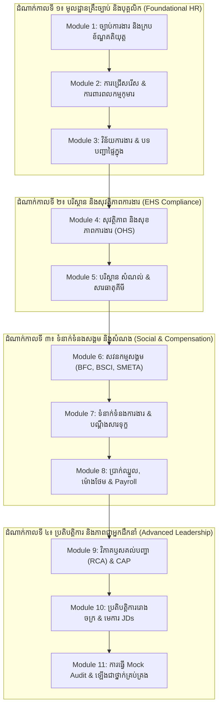
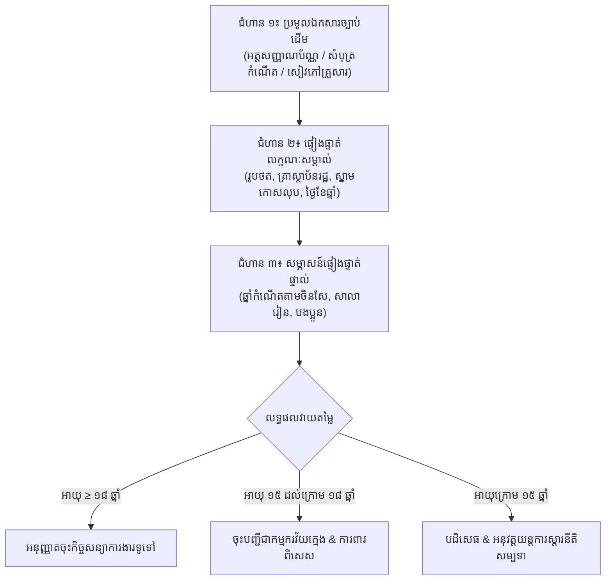
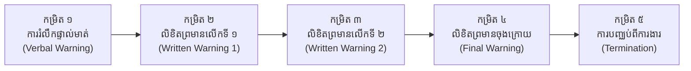
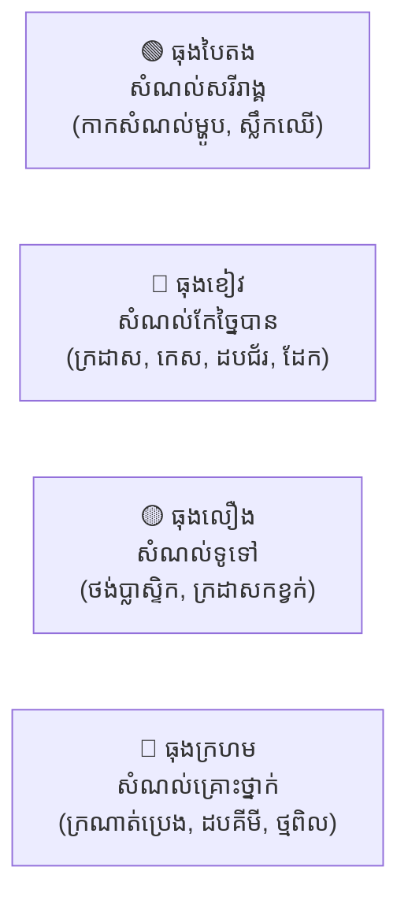
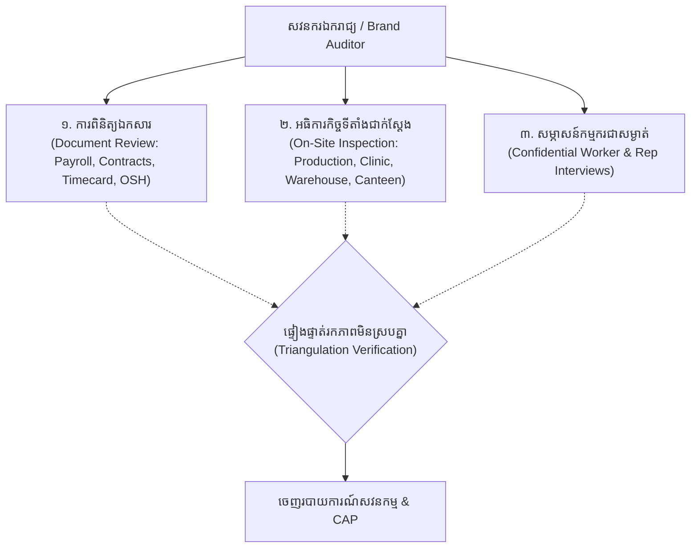
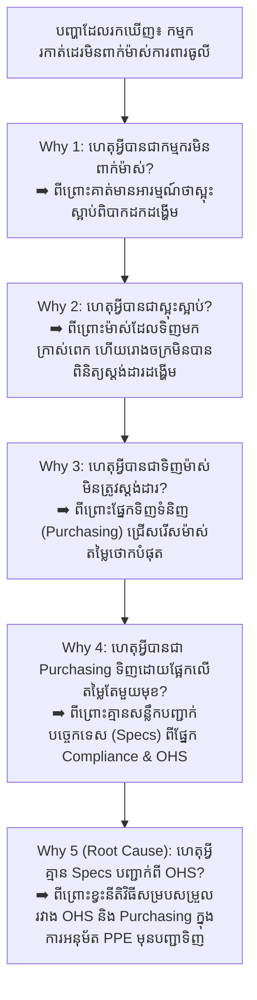
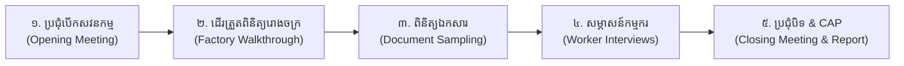
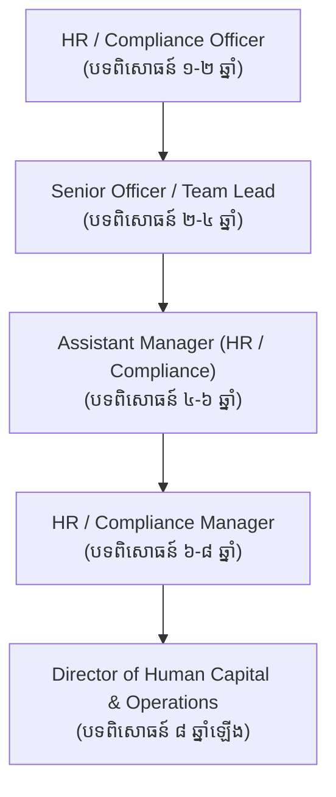

# កញ្ចប់ឯកសារវគ្គបណ្តុះបណ្តាលស្តង់ដាររោងចក្រពេញលេញ ១១ ផ្នែក
## (Comprehensive Factory HR & Compliance Management Curriculum Manual)

> **ប្រព័ន្ធគ្រប់គ្រង និងតាមដានឯកសារ (Document Control):**  
> * **កូដឯកសារ (Document Code):** `SOP-TR-2026-V2`  
> * **កំណែប្រែ (Revision):** 2.0 (កំណែពេញលេញ ១១ ផ្នែក / Master 11-Section Edition)  
> * **កាលបរិច្ឆេទអនុវត្ត (Effective Date):** ខែវិច្ឆិកា ឆ្នាំ២០២៦  
> * **វិសាលភាព (Scope):** អនុវត្តចំពោះបុគ្គលិក កម្មករ មេការ ប្រធានផ្នែក និងថ្នាក់គ្រប់គ្រងទាំងអស់ក្នុងរោងចក្រ  
> * **ផ្ទៀងផ្ទាត់តាមស្តង់ដារ (Compliance Baseline):** ច្បាប់ស្តីពីការងារនៃព្រះរាជាណាចក្រកម្ពុជា, ស្តង់ដារ Better Factories Cambodia (BFC), amfori BSCI, Sedex SMETA, WRAP និង ISO 45001 / ISO 14001

---

## ផែនទីបង្ហាញផ្លូវវគ្គបណ្តុះបណ្តាល (11-Section Curriculum Roadmap)

---

## តារាងមាតិកាពេញលេញ (Table of Contents)

1. [Module 1: ច្បាប់ស្តីពីការងារ និងក្របខ័ណ្ឌគតិយុត្ត (Essential Labor Laws & Legal Framework)](#module-1-ច្បាប់ស្តីពីការងារ-និងក្របខ័ណ្ឌគតិយុត្ត)
2. [Module 2: យុទ្ធសាស្ត្រជ្រើសរើសបុគ្គលិក និងការទប់ស្កាត់ពលកម្មកុមារ (Recruitment & Child Labor Prevention)](#module-2-យុទ្ធសាស្ត្រជ្រើសរើសបុគ្គលិក-និងការទប់ស្កាត់ពលកម្មកុមារ)
3. [Module 3: ពិធីសារគ្រប់គ្រងបុគ្គលិក វិន័យ និងបទបញ្ជាផ្ទៃក្នុង (Personnel Management & Disciplinary Protocols)](#module-3-ពិធីសារគ្រប់គ្រងបុគ្គលិក-វិន័យ-និងបទបញ្ជាផ្ទៃក្នុង)
4. [Module 4: សុវត្ថិភាព និងសុខភាពការងារ (Occupational Health & Safety - OHS)](#module-4-សុវត្ថិភាព-និងសុខភាពការងារ-ohs)
5. [Module 5: ក្រមសីលធម៌បរិស្ថាន ការគ្រប់គ្រងសំណល់ និងសារធាតុគីមី (Environmental Ethics, Chemical & Waste)](#module-5-ក្រមសីលធម៌បរិស្ថាន-ការគ្រប់គ្រងសំណល់-និងសារធាតុគីមី)
6. [Module 6: សវនកម្មទំនួលខុសត្រូវសង្គម និងស្តង់ដារអន្តរជាតិ (Social Responsibility Auditing: BFC, BSCI, SMETA, WRAP)](#module-6-សវនកម្មទំនួលខុសត្រូវសង្គម-និងស្តង់ដារអន្តរជាតិ)
7. [Module 7: ទំនាក់ទំនងការងារ កិច្ចសន្ទនាសង្គម និងយន្តការបណ្តឹងសារទុក្ខ (Industrial Relations & Grievance Mechanism)](#module-7-ទំនាក់ទំនងការងារ-កិច្ចសន្ទនាសង្គម-និងយន្តការបណ្តឹងសារទុក្ខ)
8. [Module 8: ប្រព័ន្ធប្រាក់ឈ្នួល ការគណនា Payroll និងអត្ថប្រយោជន៍ (Compensation, Benefits & Payroll Calculation)](#module-8-ប្រព័ន្ធប្រាក់ឈ្នួល-ការគណនា-payroll-និងអត្ថប្រយោជន៍)
9. [Module 9: ការវិភាគរកមូលហេតុឫសគល់ និងផែនការកែតម្រូវ (Root Cause Analysis - RCA & Corrective Action Plan - CAP)](#module-9-ការវិភាគរកមូលហេតុឫសគល់-និងផែនការកែតម្រូវ-rca--cap)
10. [Module 10: ប្រតិបត្តិការរោងចក្រ ការដឹកនាំរបស់មេការ និង Job Descriptions (Factory Operations, Supervisory Leadership & JDs)](#module-10-ប្រតិបត្តិការរោងចក្រ-ការដឹកនាំរបស់មេការ-និង-job-descriptions)
11. [Module 11: ការធ្វើសវនកម្មសាកល្បង និងការអភិវឌ្ឍឡើងជាថ្នាក់គ្រប់គ្រងជាន់ខ្ពស់ (Practical Mock Audits & Career Progression)](#module-11-ការធ្វើសវនកម្មសាកល្បង-និងការអភិវឌ្ឍឡើងជាថ្នាក់គ្រប់គ្រងជាន់ខ្ពស់)
12. [កម្រងឧបសម្ព័ន្ធ៖ កញ្ចប់ប្រតិបត្តិការ HR & Compliance Toolkit (Appendices)](#កម្រងឧបសម្ព័ន្ធ-កញ្ចប់ប្រតិបត្តិការ-hr--compliance-toolkit)

---

# Module 1: ច្បាប់ស្តីពីការងារ និងក្របខ័ណ្ឌគតិយុត្ត
### (Essential Labor Laws & Legal Framework)

> **គោលបំណង:** ធានាថាថ្នាក់គ្រប់គ្រង មន្ត្រី HR និងកម្មករនិយោជិតយល់ដឹងពីសិទ្ធិ កាតព្វកិច្ច និងក្របខ័ណ្ឌច្បាប់ការងារនៃព្រះរាជាណាចក្រកម្ពុជា ដើម្បីការពារវិវាទការងារ និងធានាការអនុលោមភាពស្របច្បាប់ ១០០%។

#### ១.១ ក្របខ័ណ្ឌកិច្ចសន្យាការងារ ៣ ប្រភេទ
1. **កិច្ចសន្យាសាកល្បងការងារ (Probation Contract):**
   - រយៈពេលអតិបរមាស្របច្បាប់៖ **៣ ខែ** សម្រាប់បុគ្គលិកជំនាញ/ការិយាល័យ, **១ ខែ** សម្រាប់កម្មករនិយោជិតជំនាញ, និង **១ សប្តាហ៍** សម្រាប់ពលកម្មសាមញ្ញ។
   - ក្នុងអំឡុងសាកល្បង ភាគីទាំងសងខាងអាចបញ្ចប់កិច្ចសន្យាបានគ្រប់ពេលវេលាដោយពុំបាច់ជូនដំណឹងមុន និងពុំមានប្រាក់បំណាច់ឡើយ ប្រសិនបើតេស្តសមត្ថភាពមិនជាប់។
2. **កិច្ចសន្យាមានថេរវេលាកំណត់ (Fixed Duration Contract - FDC):**
   - ត្រូវតែធ្វើឡើងជា **លាយលក្ខណ៍អក្សរ** ដោយកំណត់កាលបរិច្ឆេទចាប់ផ្តើម និងបញ្ចប់ច្បាស់លាស់។
   - រយៈពេលនៃកិច្ចសន្យា FDC លើកដំបូងមិនត្រូវលើសពី **២ ឆ្នាំ (២៤ ខែ)** ឡើយ។
   - **វិធានបន្តកិច្ចសន្យា:** អាចបន្តបានម្តង ឬច្រើនដង ដរាបណារយៈពេលសរុបទាំងអស់មិនលើសពី ២ ឆ្នាំ។ ប្រសិនបើបន្តលើសពី ២ ឆ្នាំ កិច្ចសន្យានោះនឹងក្លាយជាកិច្ចសន្យា UDC ដោយស្វ័យប្រវត្តិតាមមាត្រា ៦៧ នៃច្បាប់ការងារ។
   - **ការជូនដំណឹងមុន (Prior Notice):**
     - កិច្ចសន្យាក្រោម ៦ ខែ៖ មិនបាច់ជូនដំណឹងមុន (ឬយ៉ាងតិច ៧ ថ្ងៃតាមការព្រមព្រៀង)។
     - កិច្ចសន្យាពី ៦ ខែ ដល់ ១ ឆ្នាំ៖ ជូនដំណឹងមុនយ៉ាងតិច **១៥ ថ្ងៃ**។
     - កិច្ចសន្យាលើសពី ១ ឆ្នាំ ដល់ ២ ឆ្នាំ៖ ជូនដំណឹងមុនយ៉ាងតិច **១ ខែ (៣០ ថ្ងៃ)**។
   - **ប្រាក់បំណាច់បញ្ចប់កិច្ចសន្យា (Severance Pay 5%):** នៅពេលកិច្ចសន្យា FDC ផុតកំណត់ដោយមិនបន្ត និយោជកត្រូវទូទាត់ប្រាក់បំណាច់បញ្ចប់កិច្ចសន្យាយ៉ាងតិច **៥%** នៃប្រាក់ឈ្នួលសរុបដែលបានបើកក្នុងអំឡុងពេលកិច្ចសន្យា។
3. **កិច្ចសន្យាគ្មានថេរវេលាកំណត់ (Undetermined Duration Contract - UDC):**
   - អាចធ្វើឡើងជាលាយលក្ខណ៍អក្សរ ឬដោយផ្ទាល់មាត់ (ឬកើតចេញពីការបន្ត FDC លើសពី ២ ឆ្នាំ)។
   - ផ្តល់សន្តិសុខការងារខ្ពស់ និងការការពារស្របច្បាប់ម៉ឺងម៉ាត់។
   - ករណីនិយោជកបញ្ចប់កិច្ចសន្យាដោយគ្មានកំហុសធ្ងន់ ត្រូវគោរពតាមរយៈពេលជូនដំណឹងមុន (Prior Notice) និងទូទាត់ប្រាក់បំណាច់អតីតភាពការងារ (Seniority Indemnity) ព្រមទាំងប្រាក់សំណងជំងឺចិត្ត (Damages) បើការបញ្ឈប់គ្មានមូលហេតុត្រឹមត្រូវ។

#### ១.២ ម៉ោងធ្វើការ និងការឈប់សម្រាកស្របច្បាប់
* **ម៉ោងធ្វើការធម្មតា:** អតិបរមា **៨ ម៉ោងក្នុងមួយថ្ងៃ** ឬ **៤៨ ម៉ោងក្នុងមួយសប្តាហ៍**។ ត្រូវមានថ្ងៃឈប់សម្រាកប្រចាំសប្តាហ៍យ៉ាងតិច ២៤ ម៉ោងជាប់គ្នា (ជាទូទៅថ្ងៃអាទិត្យ)។
* **ការឈប់សម្រាកប្រចាំឆ្នាំ (Annual Leave):**
  - កម្មករនិយោជិតដែលធ្វើការបានពេញ ១ ឆ្នាំ មានសិទ្ធិឈប់សម្រាកប្រចាំឆ្នាំចំនួន **១៨ ថ្ងៃ** ដោយទទួលបានប្រាក់ឈ្នួលពេញ។
  - ថែម **១ ថ្ងៃ** សម្រាប់អតីតភាពការងាររៀងរាល់ **៣ ឆ្នាំ** បន្ថែម។
* **ការឈប់សម្រាកបុណ្យជាតិ (Public Holidays):** ទទួលបានការឈប់សម្រាកដោយមានប្រាក់ឈ្នួលពេញតាមប្រកាសរបស់ក្រសួងការងារ និងបណ្តុះបណ្តាលវិជ្ជាជីវៈប្រចាំឆ្នាំ។

#### ១.៣ សំណួរ-ចម្លើយគន្លឹះវាស់ស្ទង់ការយល់ដឹង (Q&A Knowledge Check)
* **❓ សំណួរ:** ប្រសិនបើកម្មករធ្វើការតាមកិច្ចសន្យា FDC ដល់ ២ ឆ្នាំពេញ ហើយរោងចក្រចង់បន្តកិច្ចសន្យាទៀត តើត្រូវធ្វើដូចម្តេច?  
  * **💡 ចម្លើយ:** រោងចក្រត្រូវប្តូរកិច្ចសន្យាទៅជា **UDC (កិច្ចសន្យាគ្មានថេរវេលាកំណត់)** ភ្លាម មិនអាចបន្តជា FDC លើកទី ៣ ឬលើសពី ២ ឆ្នាំបានទៀតឡើយ។
* **❓ សំណួរ:** តើការបញ្ឈប់កម្មករមុនកាលកំណត់នៃកិច្ចសន្យា FDC ដោយគ្មានកំហុសធ្ងន់ និយោជកត្រូវទូទាត់សំណងអ្វីខ្លះ?  
  * **💡 ចម្លើយ:** និយោជកត្រូវទូទាត់ប្រាក់ឈ្នួលដែលនៅសល់រហូតដល់ផុតកិច្ចសន្យា + ប្រាក់បំណាច់ ៥% + សំណងជំងឺចិត្តស្របតាមមាត្រា ៧៣ នៃច្បាប់ការងារ។

---

# Module 2: យុទ្ធសាស្ត្រជ្រើសរើសបុគ្គលិក និងការទប់ស្កាត់ពលកម្មកុមារ
### (Recruitment Strategies & Child Labor Prevention)

> **គោលបំណង:** បង្កើតប្រព័ន្ធជ្រើសរើសបុគ្គលិកប្រកបដោយតម្លាភាព គ្មានការរើសអើង គ្មានការបង់ថ្លៃសេវាជ្រើសរើស (Employer Pays Principle) និងធានាដាច់ខាតនូវការទប់ស្កាត់ពលកម្មកុមារ ១០០%។

#### ២.១ ពិធីសារផ្ទៀងផ្ទាត់អាយុ ៤ ជំហាន (4-Step Age Verification SOP)

#### ២.២ វិធានការការពារកម្មករវ័យក្មេង (Young Workers: Ages 15 to < 18)
1. **ការងារហាមឃាត់:** ហាមដាច់ខាតមិនឱ្យធ្វើការងារធ្ងន់ធ្ងរ ការងារពាក់ព័ន្ធនឹងសារធាតុគីមីគ្រោះថ្នាក់ ម៉ាស៊ីនកាត់ ម៉ាស៊ីនចំហាយទឹក (Boiler) និងការលើកដាក់ទម្ងន់ធ្ងន់។
2. **ម៉ោងធ្វើការ:** ហាមធ្វើការលើសពី ៨ ម៉ោងក្នុងមួយថ្ងៃ និងហាមដាច់ខាតមិនឱ្យធ្វើការងារថែមម៉ោង (OT)។
3. **ការងារវេនយប់:** ហាមធ្វើការងារនៅចន្លោះម៉ោង **១០:០០ យប់ ដល់ ០៥:០០ ព្រឹក**។
4. **ការចុះបញ្ជី:** ត្រូវមានបញ្ជីឈ្មោះកម្មករវ័យក្មេងដាច់ដោយឡែក និងរាយការណ៍ជូនអធិការកិច្ចការងារ។

#### ២.៣ នីតិវិធីស្តារនីតិសម្បទាពលកម្មកុមារ (Child Labor Remediation Policy)
ប្រសិនបើរកឃើញករណីពលកម្មកុមារ (អាយុក្រោម ១៥ ឆ្នាំ) កំពុងធ្វើការក្នុងរោងចក្រដោយអចេតនា៖
1. **ដកចេញភ្លាមៗ:** បញ្ឈប់កុមារពីការងារផលិតកម្មជាបន្ទាន់ និងនាំទៅកាន់កន្លែងសុវត្ថិភាព (បន្ទប់ HR ឬបន្ទប់ពេទ្យ)។
2. **ពិគ្រោះយោបល់ជាមួយអាណាព្យាបាល:** ទាក់ទងឪពុកម្តាយ ឬអាណាព្យាបាលស្របច្បាប់ និងអង្គការសង្គមស៊ីវិលពាក់ព័ន្ធ។
3. **គាំទ្រការអប់រំ:** រោងចក្រត្រូវបន្តឧបត្ថម្ភប្រាក់ស្មើនឹងប្រាក់ឈ្នួលអប្បបរមាប្រចាំខែជូនកុមាររហូតដល់កុមារគ្រប់អាយុ ១៥ ឆ្នាំ ដោយភ្ជាប់លក្ខខណ្ឌថាកុមារត្រូវចូលរៀននៅសាលា។
4. **ឱកាសការងារពេលគ្រប់អាយុ:** ផ្តល់អាទិភាពទទួលកុមារឱ្យចូលបម្រើការងារវិញនៅពេលគ្រប់អាយុស្របច្បាប់។

---

# Module 3: ពិធីសារគ្រប់គ្រងបុគ្គលិក វិន័យ និងបទបញ្ជាផ្ទៃក្នុង
### (Personnel Management & Disciplinary Protocols)

> **គោលបំណង:** រៀបចំប្រព័ន្ធគ្រប់គ្រងវត្តមាន វិន័យការងារ និងការលើកទឹកចិត្តប្រកបដោយតម្លាភាព ផ្អែកលើបទបញ្ជាផ្ទៃក្នុងដែលបានតម្កល់ស្របច្បាប់នៅក្រសួងការងារ។

#### ៣.១ ឋានានុក្រមនៃវិធានការវិន័យ ៥ កម្រិត (Progressive Discipline Hierarchy)

#### ៣.២ វិធានការអនុវត្តលិខិតព្រមានស្របច្បាប់
1. **សុពលភាពលិខិតព្រមាន:** លិខិតព្រមានជាលាយលក្ខណ៍អក្សរនីមួយៗមានសុពលភាពមិនលើសពី **៣ ខែ** (ឬអតិបរមា ៦ ខែតាមបទបញ្ជាផ្ទៃក្នុងដែលបានអនុម័ត)។ ក្រោយផុតកំណត់ កំហុសត្រូវលុបចោលពីសំណុំរឿង។
2. **សិទ្ធិតវ៉ា និងតំណាង:** កម្មករមានសិទ្ធិពន្យល់ពីហេតុផលរបស់ខ្លួន និងមានវត្តមានតំណាងកម្មករ ឬសហជីពចូលរួមស្តាប់មុនពេលចុះហត្ថលេខាលើលិខិតព្រមាន។
3. **ការបដិសេធមិនព្រមស៊ីញ៉េ:** ប្រសិនបើកម្មករប្រព្រឹត្តខុសពិតប្រាកដតែបដិសេធមិនព្រមចុះហត្ថលេខា HR ត្រូវមានសាក្សីយ៉ាងតិច ២ នាក់ (ប្រធានផ្នែក និងតំណាងកម្មករ) ចុះហត្ថលេខាបញ្ជាក់លើលិខិតនោះ។

#### ៣.៣ និយមន័យកំហុសស្រាល និងកំហុសធ្ងន់
* **កំហុសស្រាល (Minor Offenses):** មកយឺតញឹកញាប់ដោយគ្មានមូលហេតុ, មិនពាក់កាតបុគ្គលិក, មិនពាក់ PPE ធម្មតា, និយាយទូរសព្ទក្នុងខ្សែដេរ។ ➡️ *ដោះស្រាយតាមវិធានការព្រមានជាជំហានៗ។*
* **កំហុសធ្ងន់ (Serious Misconduct - មាត្រា ៨៣ នៃច្បាប់ការងារ):** លួចទ្រព្យសម្បត្តិរោងចក្រ, ប្រើប្រាស់អំពើហិង្សា/វាយតប់គ្នា, ជេរប្រមាថ ឬគំរាមកំហែងធ្ងន់ធ្ងរ, ញុះញង់ឱ្យមានការបះបោរខុសច្បាប់, ក្លែងបន្លំឯកសារ ឬទិន្នន័យស្កេនមេដៃ។ ➡️ *អាចបញ្ឈប់ពីការងារភ្លាមៗដោយគ្មានសំណងជូនដំណឹងមុន ឬប្រាក់បំណាច់បញ្ចប់កិច្ចសន្យាឡើយ។*

---

# Module 4: សុវត្ថិភាព និងសុខភាពការងារ (OHS)
### (Occupational Health & Safety)

> **គោលបំណង:** កសាងវប្បធម៌សុវត្ថិភាពការងារសូន្យគ្រោះថ្នាក់ (Zero-Harm Culture) បង្ការជំងឺវិជ្ជាជីវៈ និងធានាការអនុលោមតាមបទដ្ឋានអន្តរជាតិ OHSAS / ISO 45001។

#### ៤.១ រចនាសម្ព័ន្ធ និងតួនាទីគណៈកម្មការ OSH
* សមាសភាពគណៈកម្មការត្រូវមានសមាមាត្រស្មើគ្នារវាង **តំណាងនិយោជក** (HR Manager, Compliance Manager, Maintenance Manager) និង **តំណាងកម្មករ** (Worker Reps, Clinic Nurse, កម្មករស្រ្តី)។
* **កាតព្វកិច្ចសំខាន់ៗ:**
  - ត្រួតពិនិត្យសុវត្ថិភាពរួមគ្នាប្រចាំខែ (Joint Monthly Safety Walkthrough)។
  - ស៊ើបអង្កេតរាល់គ្រោះថ្នាក់ការងារ (Near-Miss & Accident Investigation) ក្នុងរយៈពេល ២៤ ម៉ោង។
  - រៀបចំការហ្វឹកហាត់ពន្លត់អគ្គិភ័យ និងការជម្លៀសខ្លួនចេញ (Evacuation Drill) យ៉ាងតិច **២ ដងក្នុងមួយឆ្នាំ**។

#### ៤.២ ស្តង់ដារសុវត្ថិភាពអគ្គិសនី និងប្រព័ន្ធពន្លត់អគ្គិភ័យ
| ផ្នែកត្រួតពិនិត្យ | ស្តង់ដារបច្ចេកទេសតម្រូវ | ហានិភ័យប្រសិនបើមិនអនុវត្ត |
| :--- | :--- | :--- |
| **ទូបញ្ជាអគ្គិសនី (Main Breaker / DB Panel)** | មានគម្របបិទជិត, មានសោសុវត្ថិភាព, ដាក់ស្លាកសញ្ញាគ្រោះថ្នាក់, **ទុកគម្លាតទទេមុខទូយ៉ាងតិច ១ ម៉ែត្រ** | ឆ្លងចរន្តអគ្គិសនី, រាំងស្ទះពេលត្រូវការកាត់ផ្តាច់ភ្លើងបន្ទាន់ |
| **បំពង់ពន្លត់អគ្គិភ័យ (Extinguishers)** | ព្យួរកម្ពស់អតិបរមា ១.៥ ម៉ែត្រ, ពិនិត្យកុងទ័រវាស់សម្ពាធ (សញ្ញាព្រួញនៅតំបន់បៃតង) ប្រចាំខែ, គ្មានសម្ភារៈរាំងស្ទះ | មិនដំណើរការពេលមានអគ្គិភ័យ, ពិបាកដោះយកមកប្រើ |
| **ផ្លូវ និងច្រកចេញសង្គ្រោះបន្ទាន់ (Emergency Exits)** | ទ្វាររុញចេញក្រៅ (Push Bar), មិនចាក់សោក្នុងម៉ោងការងារ, មានភ្លើងសញ្ញា Exit បំភ្លឺជាប់ និងអាគុយជំនួយ ៩០ នាទី | កម្មករជាប់គាំងពេលមានអាសន្ន បង្កជាមហន្តរាយស្លាប់មនុស្ស |
| **ខ្សែភ្លើង និងម៉ាស៊ីនផលិតកម្ម** | មានខ្សែតដី (Grounding Wire), គ្មានខ្សែភ្លើងស្រាត ឬរុំស្កុតគ្មានស្តង់ដារ | ឆក់កម្មករ, បង្កជាអណ្តាតភ្លើងឆេះក្រណាត់ |

#### ៤.៣ ស្តង់ដារបន្ទប់ពេទ្យ និងប្រអប់ First Aid
* **ប្រអប់សង្គ្រោះបឋម (First Aid Box):** ត្រូវបំពាក់ ១ ប្រអប់ សម្រាប់កម្មកររៀងរាល់ ៥០ ដល់ ១០០ នាក់។ ត្រូវមានសម្ភារៈស្តង់ដារ ១៦ មុខគ្រប់គ្រាន់ (បង់រុំរបួស, សំឡី, ថ្នាំសម្លាប់មេរោគ Betadine, កន្ត្រៃ, ស្រោមដៃពេទ្យ, ថ្នាំបំបាត់ការឈឺចាប់Paracetamol) និង **ហាមដាច់ខាតមិនឱ្យចាក់សោក្នុងអំឡុងពេលធ្វើការ**។
* **បន្ទប់សុខាភិបាល (Factory Clinic):** រោងចក្រដែលមានកម្មករចាប់ពី ៥០ នាក់ឡើងទៅ ត្រូវមានបន្ទប់ពេទ្យ និងគិលានុបដ្ឋាក/វេជ្ជបណ្ឌិតប្រចាំការដែលមានអាជ្ញាប័ណ្ណត្រឹមត្រូវ ព្រមទាំងមានគ្រែសម្រាក និងបញ្ជីកត់ត្រាជំងឺប្រចាំថ្ងៃ។

---

# Module 5: ក្រមសីលធម៌បរិស្ថាន ការគ្រប់គ្រងសំណល់ និងសារធាតុគីមី
### (Environmental Ethics, Chemical & Waste Management)

> **គោលបំណង:** កាត់បន្ថយផលប៉ះពាល់បរិស្ថាន ការពារសុខភាពអ្នកធ្វើការពីសារធាតុពុល និងធានាការគ្រប់គ្រងសំណល់ស្របតាមច្បាប់បរិស្ថាន និងស្តង់ដារ Higg FEM / ZDHC។

#### ៥.១ ការបែងចែក និងគ្រប់គ្រងសំណល់រឹង ៤ ប្រភេទ

* **ឃ្លាំងផ្ទុកសំណល់គ្រោះថ្នាក់ (Hazardous Waste Storage):** ត្រូវមានដំបូលការពារទឹកភ្លៀង មានជញ្ជាំងសំណាញ់ខ្យល់ចេញចូល មានអាងទប់ទឹកហៀរ (Containment Bund) មានផ្លាកសញ្ញាព្រមាន និងមានកិច្ចសន្យាជាមួយក្រុមហ៊ុនប្រមូលសំណល់ដែលទទួលស្គាល់ដោយក្រសួងបរិស្ថាន។

#### ៥.២ សុវត្ថិភាពសារធាតុគីមី (Chemical Management & GHS)
1. **សន្លឹកទិន្នន័យសុវត្ថិភាព (SDS):** គ្រប់សារធាតុគីមីទាំងអស់ (ប្រេងម៉ាស៊ីន, ទឹកបាញ់ចំណុចប្រឡាក់ Spot Lifter, ទឹកថ្នាំពណ៌, កាវ) ត្រូវតែមានសន្លឹក SDS ជា **ភាសាខ្មែរ** និងភាសាអង់គ្លេសបិទនៅជិតកន្លែងប្រើប្រាស់។
2. **អាងស្តុកបន្ទាប់បន្សំ (Secondary Containment):** គ្រប់ធុងគីមីត្រូវតែដាក់លើថាស ឬអាងទប់ដែលអាចផ្ទុកចំណុះបានយ៉ាងតិច **១១០%** នៃធុងធំបំផុត ដើម្បីការពារកុំឱ្យហូរជ្រាបចូលដីពេលធ្លាយធុង។
3. **កន្លែងលាងភ្នែក និងងូតទឹកបន្ទាន់ (Eyewash & Shower):** ត្រូវបំពាក់នៅចម្ងាយមិនលើសពី **១០ វិនាទីនៃការដើរ** ពីតំបន់ប្រើប្រាស់គីមី និងត្រូវត្រួតពិនិត្យលំហូរទឹកស្អាតរៀងរាល់សប្តាហ៍។

---

# Module 6: សវនកម្មទំនួលខុសត្រូវសង្គម និងស្តង់ដារអន្តរជាតិ
### (Social Responsibility Auditing: BFC, BSCI, SMETA, WRAP)

> **គោលបំណង:** បំពាក់បំប៉នជំនាញសវនកម្មសង្គម យល់ដឹងពីវិធីសាស្ត្រវាយតម្លៃរបស់អ្នកបញ្ជាទិញ និងទប់ស្កាត់បញ្ហាអសកម្ម Zero Tolerance ដាច់ខាត។

#### ៦.១ ការប្រៀបធៀបស្តង់ដារសវនកម្មសង្គមចម្បងៗ
| ស្តង់ដារសវនកម្ម | ស្ថាប័នគ្រប់គ្រង | ចំណុចផ្តោតសំខាន់ | វិធីសាស្ត្រវាយតម្លៃ |
| :--- | :--- | :--- | :--- |
| **BFC (Better Factories Cambodia)** | ILO & IFC | ច្បាប់ការងារកម្ពុជា & ស្តង់ដារស្នូល ILO | ការចុះពិនិត្យដោយមិនប្រកាសមុន (Unannounced Visits) |
| **amfori BSCI** | amfori Global | ក្រមសីលធម៌ពាណិជ្ជកម្ម ១៣ ផ្នែក | កម្រិតពិន្ទុពី A (Very Good) ដល់ E (Unacceptable) |
| **Sedex SMETA** | Sedex Global | សសរស្ដម្ភ ២ ឬ ៤ (Labor, Health, Environment, Business Ethics) | របាយការណ៍សវនកម្មលើប្រព័ន្ធ Sedex Advance |
| **WRAP** | Worldwide Responsible Accredited Production | គោលការណ៍ ១២ ប្រការសម្រាប់ឧស្សាហកម្មកាត់ដេរ | វិញ្ញាបនបត្រកម្រិត Platinum (2 ឆ្នាំ), Gold (1 ឆ្នាំ), Silver |

#### ៦.២ ដំណើរការសវនកម្ម ៣ ត្រីកោណ (Audit Triangulation Process)

#### ៦.៣ បញ្ហា Zero Tolerance ដែលត្រូវទប់ស្កាត់ដាច់ខាត (Non-Negotiable Violations)
* ❌ **ពលកម្មកុមារ (Child Labor):** រកឃើញកុមារអាយុក្រោម ១៥ ឆ្នាំធ្វើការ។
* ❌ **ពលកម្មដោយបង្ខំ (Forced Labor):** កាត់ទុកលិខិតឆ្លងដែន/កាតច្បាប់ដើម, ចាក់សោទ្វាររោងចក្រមិនឱ្យចេញក្រៅ, បង្ខំធ្វើការថែមម៉ោងដោយគំរាមកំហែង។
* ❌ **ការបំពានរាងកាយ និងផ្លូវភេទ (Physical / Sexual Abuse):** វាយដំ ជេរប្រមាថ ឬបៀតបៀនផ្លូវភេទ។
* ❌ **ការក្លែងបន្លំឯកសារ ឬការសូកប៉ាន់ (Bribery & Double Books):** ធ្វើតារាងប្រាក់ខែ ឬម៉ោងស្កេនក្លែងបន្លំដើម្បីបន្លំភ្នែកសវនករ។

---

# Module 7: ទំនាក់ទំនងការងារ កិច្ចសន្ទនាសង្គម និងយន្តការបណ្តឹងសារទុក្ខ
### (Industrial Relations & Grievance Mechanism)

> **គោលបំណង:** បង្កើតបរិយាកាសការងារប្រកបដោយភាពសុខដុមរមនា ការពារកូដកម្មខុសច្បាប់ លើកកម្ពស់កិច្ចសន្ទនាសង្គម និងធានាថាគ្រប់បណ្តឹងត្រូវបានដោះស្រាយដោយយុត្តិធម៌។

#### ៧.១ យន្តការទទួលបណ្តឹងសារទុក្ខ ៤ ផ្លូវ (4-Channel Grievance SOP)
1. **ប្រអប់បណ្តឹង (Grievance Suggestion Box):** ដាក់នៅទីតាំងដែលគ្មានកាមេរ៉ាសុវត្ថិភាព (ជិតបន្ទប់ទឹក ឬអាហារដ្ឋាន) ដើម្បីធានាការសម្ងាត់។ បើកពិនិត្យជារៀងរាល់ ២ សប្តាហ៍ម្តងដោយមានវត្តមានរួមគ្នារវាង HR និងតំណាងកម្មករ។
2. **តំណាងកម្មករ / ប្រតិភូបុគ្គលិក:** កម្មករអាចរាយការណ៍ផ្ទាល់ទៅតំណាងរបស់ពួកគេដើម្បីលើកយកមកពិភាក្សាក្នុងកិច្ចប្រជុំប្រចាំខែជាមួយថ្នាក់គ្រប់គ្រង។
3. **ទូរសព្ទ Hotline ឬ Telegram ផ្ទៃក្នុង:** លេខទូរសព្ទផ្ទាល់របស់ប្រធាន Compliance ឬ HR សម្រាប់ករណីបន្ទាន់ ឬករណីបៀតបៀនផ្លូវភេទ។
4. **ការជួបពិភាក្សាផ្ទាល់ (Open Door Policy):** កម្មករអាចស្នើសុំជួបពិភាក្សាជាមួយផ្នែក HR ដោយផ្ទាល់។

#### ៧.២ គោលការណ៍រក្សាការសម្ងាត់ និងការការពារគ្មានការសងសឹក (Zero Retaliation)
* រោងចក្រធានាដាច់ខាតថាមិនមានការផ្ទេរការងារ បន្ថយមុខតំណែង កាត់ប្រាក់រង្វាន់ ឬការរើសអើងណាមួយចំពោះកម្មករដែលបានដាក់ពាក្យបណ្តឹង ឬផ្តល់ព័ត៌មានដល់សវនករឡើយ។ ប្រសិនបើមេការណាប្រព្រឹត្តការសងសឹក នឹងត្រូវទទួលទណ្ឌកម្មវិន័យកម្រិតខ្ពស់រហូតដល់បញ្ឈប់ពីការងារ។

---

# Module 8: ប្រព័ន្ធប្រាក់ឈ្នួល ការគណនា Payroll និងអត្ថប្រយោជន៍
### (Compensation, Benefits & Payroll Calculation)

> **គោលបំណង:** បំពាក់បំប៉នជំនាញគណនាប្រាក់ឈ្នួល និងម៉ោងថែមឱ្យបានត្រឹមត្រូវ ១០០% ស្របតាមច្បាប់ការងារកម្ពុជា ការកាត់វិភាគទាន ប.ស.ស. និងប្រាក់បំណាច់អតីតភាពការងារ។

#### ៨.១ រូបមន្តគណនាប្រាក់ឈ្នួល និងម៉ោងថែម (OT Formulas)
* **ប្រាក់ឈ្នួលក្នុងមួយម៉ោង (Hourly Wage Rate):**
  $$	ext{ប្រាក់ម៉ោង} = rac{	ext{ប្រាក់ខែគោល (Basic Wage)}}{២៦ 	ext{ ថ្ងៃ} 	imes ៨ 	ext{ ម៉ោង}} = rac{	ext{Basic Wage}}{២០៨}$$
* **អត្រាគណនាម៉ោងថែម (OT Multipliers):**
  - **ថែមម៉ោងថ្ងៃធម្មតា (ម៉ោង ០៤:០០ រសៀល ដល់ ១០:០០ យប់):** $	ext{ប្រាក់ម៉ោង} 	imes ១.៥ 	ext{ (150%)}$
  - **ថែមម៉ោងវេនយប់ធម្មតា (ម៉ោង ១០:០០ យប់ ដល់ ០៦:០០ ព្រឹក):** $	ext{ប្រាក់ម៉ោង} 	imes ២.០ 	ext{ (200%)}$
  - **ថែមម៉ោងថ្ងៃអាទិត្យ ឬថ្ងៃឈប់សម្រាកបុណ្យជាតិ:** $	ext{ប្រាក់ម៉ោង} 	imes ២.០ 	ext{ (200%)}$ បូកបន្ថែមប្រាក់ថ្លៃបាយថ្ងៃបុណ្យ។

#### ៨.២ ការគណនាវិភាគទានរបបសន្តិសុខសង្គម (NSSF Calculation)
1. **ផ្នែកហានិភ័យការងារ (Occupational Risk):** ០.៨% នៃប្រាក់ឈ្នួលជាប់ភាគទាន (និយោជកបង់ ១០០%)។
2. **ផ្នែកថែទាំសុខភាព (Health Care):** ២.៦% នៃប្រាក់ឈ្នួលជាប់ភាគទាន (និយោជកបង់ ១០០%)។
3. **ផ្នែកប្រាក់សោធននិវត្តន៍ (Pension Scheme):** សរុប ៤% នៃប្រាក់ឈ្នួលជាប់ភាគទាន (និយោជកបង់ ២% និងកាត់ពីកម្មករនិយោជិត ២%) ជាមួយនឹងពិតានប្រាក់ឈ្នួលជាប់ភាគទានអតិបរមា ១,២០០,០០០ រៀល (~$300)។

#### ៨.៣ ប្រាក់បំណាច់អតីតភាពការងារ (Seniority Indemnity) សម្រាប់កិច្ចសន្យា UDC
* កម្មករកិច្ចសន្យា UDC ទទួលបានប្រាក់បំណាច់អតីតភាពចំនួន **១៥ ថ្ងៃក្នុងមួយឆ្នាំ** ដោយបែងចែកបើកជា ២ លើក៖
  - **លើកទី ១ (ខែមិថុនា):** បើកចំនួន **៧.៥ ថ្ងៃ** នៃប្រាក់ឈ្នួល និងប្រាក់បន្ទាប់បន្សំមធ្យម ៦ ខែដើមឆ្នាំ។
  - **លើកទី ២ (ខែធ្នូ):** បើកចំនួន **៧.៥ ថ្ងៃ** នៃប្រាក់ឈ្នួល និងប្រាក់បន្ទាប់បន្សំមធ្យម ៦ ខែចុងឆ្នាំ។

---

# Module 9: ការវិភាគរកមូលហេតុឫសគល់ និងផែនការកែតម្រូវ
### (Root Cause Analysis - RCA & Corrective Action Plan - CAP)

> **គោលបំណង:** បង្រៀនមន្ត្រី HR និង Compliance ឱ្យចេះដោះស្រាយបញ្ហាមិនស្របតាមស្តង់ដារ (Non-Compliance Findings) ដល់ឫសគល់ មិនមែនគ្រាន់តែកែលើផ្ទៃខាងក្រៅនោះឡើយ។

#### ៩.១ វិធីសាស្ត្រវិភាគ RCA ដោយប្រើ 5 Whys Technique

#### ៩.២ រចនាសម្ព័ន្ធផែនការកែតម្រូវ CAP ស្តង់ដារ ៨ ជួរ
| ល.រ | ចំណុចអសកម្ម (Finding) | មូលហេតុឫសគល់ (Root Cause) | សកម្មភាពកែតម្រូវភ្លាមៗ (Corrective Action) | សកម្មភាពបង្ការកុំឱ្យកើតឡើងវិញ (Preventive Action) | អ្នកទទួលខុសត្រូវ (PIC) | កាលបរិច្ឆេទកំណត់ (Deadline) | ស្ថានភាព & ភស្តុតាង (Status & Evidence) |
| :---: | :--- | :--- | :--- | :--- | :--- | :---: | :--- |
| 1 | ច្រកចេញអាសន្នត្រូវចាក់សោ | មេការខ្លាចបាត់ក្រណាត់ពេលយប់ | ដោះសោចេញភ្លាមៗ | បំពាក់ប្រព័ន្ធរោទ៍អាសន្ន Emergency Push-Bar និងកាមេរ៉ាសុវត្ថិភាព | Maintenance / Compliance | 7 ថ្ងៃ | បានបិទ (រូបថត & កំណត់ហេតុ) |
| 2 | រកឃើញកម្មករអាយុ ១៤ ឆ្នាំ ៩ ខែ | ប្រើប្រាស់កាតបងស្រីមកដាក់ពាក្យ | បញ្ឈប់ពីខ្សែដេរ និងឧបត្ថម្ភការសិក្សា | កែលម្អ SOP ពិនិត្យអាយុដោយផ្ទៀងផ្ទាត់សំបុត្រកំណើតច្បាប់ដើម | HR Manager | ៣ ថ្ងៃ | កំពុងតាមដានការចូលរៀន |

---

# Module 10: ប្រតិបត្តិការរោងចក្រ ការដឹកនាំរបស់មេការ និង Job Descriptions
### (Factory Operations, Supervisory Leadership & JDs)

> **គោលបំណង:** ពង្រឹងសមត្ថភាពដឹកនាំរបស់ប្រធានក្រុម និងមេការ (Supervisors/Line Leaders) ក្នុងការគ្រប់គ្រងខ្សែសង្វាក់ផលិតកម្មប្រកបដោយប្រសិទ្ធភាព គោរពសិទ្ធិកម្មករ និងចៀសវាងការស្រែកគំហក។

#### ១០.១ គោលការណ៍ដឹកនាំវិជ្ជមាន ៤ យ៉ាងសម្រាប់មេការ
1. **ការប្រាស្រ័យទាក់ទងវិជ្ជមាន (Respectful Communication):** ហាមដាច់ខាតការស្រែកគំហក ជេរប្រមាថ គោះតុ ឬប្រើពាក្យអសុរសចំពោះកម្មករ។ បើកម្មករធ្វើខុស ត្រូវហៅមកណែនាំដោយឡែកដោយសន្តិវិធី។
2. **ការគ្រប់គ្រងម្ជុលបាក់ និងឧបករណ៍មុតស្រួច (Sharp Tools & Broken Needle Policy):**
   - រាល់ពេលម្ជុលបាក់ កម្មករត្រូវប្រមូលបំណែកម្ជុលបាក់ឱ្យគ្រប់ ១០០% យកមកបិទលើសន្លឹកកំណត់ត្រាម្ជុលបាក់ (Broken Needle Log) ទើបមេការប្តូរម្ជុលថ្មីជូន។
   - ប្រសិនបើរករកបំណែកម្ជុលមិនឃើញ ផលិតផលនោះត្រូវយកទៅរាវម៉ាស៊ីន Handheld Detector និងម៉ាស៊ីនរាវកាត់ក្រណាត់ជាបន្ទាន់។
3. **ការគ្រប់គ្រង 5S និងលំហូរសម្ភារៈ:** តម្រៀបសម្ភារៈតាមខ្សែបន្ទាត់លឿង មិនដាក់ទំនិញរាំងស្ទះផ្លូវដើរ ឬផ្លូវពន្លត់អគ្គិភ័យ។
4. **ការក្រិតម៉ាស៊ីនរាវម្ជុល (Needle Detector Calibration):** ត្រូវក្រិតក្បាលរាវដោយប្រើបន្ទះតេស្ត 9-Point Calibration រៀងរាល់ **២ ម៉ោងម្តង** និងកត់ត្រាទុកក្នុងសៀវភៅតាមដាន។

---

# Module 11: ការធ្វើសវនកម្មសាកល្បង និងការអភិវឌ្ឍឡើងជាថ្នាក់គ្រប់គ្រងជាន់ខ្ពស់
### (Practical Mock Audits & Career Progression to Senior Management)

> **គោលបំណង:** ផ្តល់ការបណ្តុះបណ្តាលអនុវត្តជាក់ស្តែងតាមរយៈការធ្វើ Mock Audit ផ្ទៃក្នុង និងរៀបចំផែនទីបង្ហាញផ្លូវអាជីព (Career Roadmap) សម្រាប់បុគ្គលិក HR & Compliance ឡើងកាន់តំណែងគ្រប់គ្រងជាន់ខ្ពស់។

#### ១១.១ ដំណើរការធ្វើ Mock Audit ផ្ទៃក្នុង ៥ ដំណាក់កាល

* **ការរៀបចំរបាយការណ៍សវនកម្មជូនថ្នាក់ដឹកនាំ (Executive Audit Summary):**
  - បង្ហាញបញ្ហាធ្ងន់ធ្ងរ (High-Risk Findings) ដែលអាចធ្វើឱ្យរោងចក្រធ្លាក់សវនកម្ម Brand។
  - គណនាផលប៉ះពាល់ហិរញ្ញវត្ថុ និងកេរ្តិ៍ឈ្មោះរោងចក្រ។
  - ស្នើសុំកញ្ចប់ថវិកាកែតម្រូវ (CAP Budget) និងកាលវិភាគអនុវត្តជាក់ស្តែងជូន General Manager អនុម័ត។

#### ១១.២ ផែនទីបង្ហាញផ្លូវអភិវឌ្ឍន៍អាជីព (Career Progression Roadmap)

---

# កម្រងឧបសម្ព័ន្ធ៖ កញ្ចប់ប្រតិបត្តិការ HR & Compliance Toolkit
### (Operational Appendices & Templates)

#### ឧបសម្ព័ន្ធ ក៖ តារាងតាមដានកិច្ចសន្យាការងារ FDC / UDC Tracker (គំរូអនុវត្ត)
| ល.រ | អត្តលេខ | ឈ្មោះបុគ្គលិក | ភេទ | ថ្ងៃចូលធ្វើការ | ប្រភេទកិច្ចសន្យា | ថ្ងៃចាប់ផ្តើម | ថ្ងៃផុតកំណត់ | FDC លើកទី | សកម្មភាពត្រូវចាត់ចែង | ស្ថានភាព |
| :---: | :---: | :---: | :---: | :---: | :---: | :---: | :---: | :---: | :---: | :---: |
| 1 | EMP-001 | បុគ្គលិក គំរូ ក | ប្រុស | 24/11/2025 | FDC 3 ខែ | 24/11/2025 | 23/02/2026 | 1 | ចេញលិខិតជូនដំណឹងបន្ត FDC លើកទី ២ | រួចរាល់ |
| 2 | EMP-002 | បុគ្គលិក គំរូ ខ | ស្រី | 08/01/2026 | FDC 3 ខែ | 08/01/2026 | 07/03/2026 | 1 | ជូនដំណឹងមុន ១៥ ថ្ងៃ | កំពុងដំណើរការ |
| 3 | EMP-003 | បុគ្គលិក គំរូ គ | ប្រុស | 17/11/2024 | FDC 2 ឆ្នាំពេញ | 17/11/2024 | 16/11/2026 | ចុងក្រោយ | រៀបចំកិច្ចសន្យា UDC (ហាមបន្ត FDC) | ត្រូវប្តូរជា UDC |

#### ឧបសម្ព័ន្ធ ខ៖ តារាងគណនា Payroll ស្តង់ដារ (Anonymized Calculation Sample)
| ល.រ | អត្តលេខ | មុខតំណែង | ប្រាក់ខែគោល | ថ្ងៃធ្វើការ | ប្រាក់ខែតាមថ្ងៃ | ម៉ោង OT | ប្រាក់ម៉ោង OT (150%) | ឧបត្ថម្ភផ្សេងៗ | ប្រាក់សរុប (Gross) | កាត់ ប.ស.ស. (2%) | ប្រាក់បើកលើកទី១ | ប្រាក់នៅសល់ត្រូវបើក |
| :---: | :---: | :---: | :---: | :---: | :---: | :---: | :---: | :---: | :---: | :---: | :---: | :---: |
| 1 | 001 | កាត់ដេរ | $208.00 | 26 | $208.00 | 20 ម៉ោង | $30.00 | $23.50 | $261.50 | $5.99 | $105.00 | $150.51 |
| 2 | 002 | វេចខ្ចប់ | $208.00 | 24 | $192.00 | 10 ម៉ោង | $15.00 | $20.00 | $227.00 | $5.50 | $105.00 | $116.50 |

---

### កំណត់ត្រាកំណែប្រែឯកសារ (Document Revision History)
| កាលបរិច្ឆេទ | កំណែប្រែ (Rev.) | ជំពូក/ទំព័រដែលបានកែសម្រួល | មូលហេតុនៃការកែសម្រួល | អ្នករៀបចំ | អ្នកអនុម័ត |
| :---: | :---: | :---: | :---: | :---: | :---: |
| 17/11/2026 | 1.0 | ឯកសារទាំងមូល | ចងក្រងកញ្ចប់បណ្តុះបណ្តាល ៤ ម៉ូឌុលដំបូង | HR Officer | General Manager |
| 19/11/2026 | 2.0 | ឯកសារទាំងមូល | ពង្រីកជាកញ្ចប់ Master Curriculum ពេញលេញ ១១ ផ្នែក ស្របតាមស្តង់ដារ BFC/BSCI/SMETA | HR & Compliance Team | General Manager |
